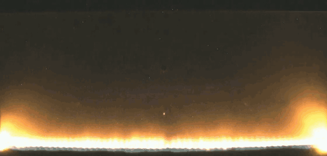
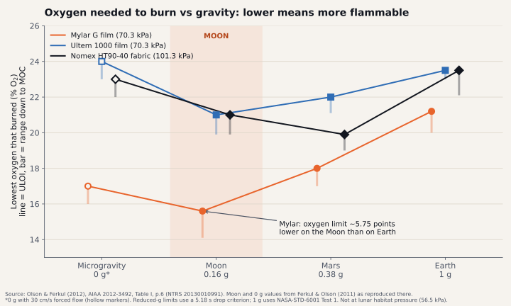
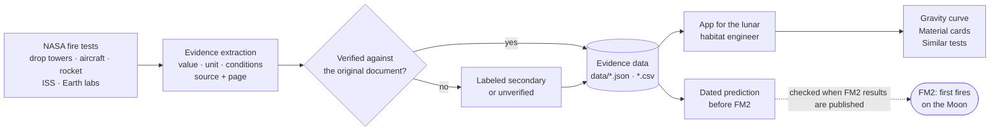

# Before the First Fire on the Moon

  

A real fire in microgravity, sped up 5×. Video: NASA, <a href="https://images.nasa.gov/details/Saf-VI%20S8C3+C4%201-sided%20PMMA_unmapped_jpeg-20x%20no%20text">Saffire-VI experiment inside Northrop Grumman's Cygnus spacecraft</a> (2024).

**NASA approves spacecraft materials by testing them on Earth. Before the first fire on the Moon, we show which materials might behave differently there, and what the evidence actually says.**

Built for the **NASA Space Apps Challenge 2026** · Challenge: *Flame in Freefall: AI-Powered Fire Safety Insights from Microgravity Combustion Data* · Team from Montevideo, Uruguay.

> 🚧 Work in progress during the hackathon (Nov 14–15, 2026).

---

## The problem

- NASA screens materials for crewed missions with a flammability test performed in **Earth gravity** (NASA-STD-6001B, Test 1). A material that passes is considered acceptable for flight.
- But gravity changes how a flame gets its oxygen. NASA researchers note that **some materials that do not burn in 1 g can burn in microgravity or partial gravity**, and that **lunar gravity may be one of the most hazardous conditions** (Ferkul et al., LPSC 2026).
- Future lunar habitats are planned with **34% oxygen at 8.2 psi**, a richer atmosphere than the one on the International Space Station.
- NASA's **FM2 experiment (Flammability of Materials on the Moon)** will run the **first fires ever lit on another world** to measure this directly. Until its results arrive, engineers have to design with the evidence that already exists.

## What we are building

A decision-support tool for **the engineer who designs the materials and ventilation of a lunar habitat**.

| Screen | What it shows |
|---|---|
| **Gravity curve** | How much oxygen each material needs to burn on Earth, Mars, the Moon and in microgravity, from NASA drop-tower, aircraft, rocket and space-station tests |
| **Material cards** | Which materials become *more* flammable in lunar gravity and which become *less*, with the source for each result |
| **Similar tests** | Pick oxygen, airflow and gravity: the tool finds the closest NASA tests, explains what matches and what differs, and says plainly when **no matching test exists in the data we reviewed** |
| **Our bet before FM2** | A dated, falsifiable prediction written *before* FM2 results, to be checked when NASA publishes them |
| **Simulation** *(optional)* | Heat transport around a sample under different gravity and ventilation, clearly labeled as a simulation |

## What the data already shows

  

Generated from <code>data/curva_gravedad.json</code> with <code>scripts/plot_gravity_curve.py</code>. Source: Olson &amp; Ferkul (2012), Table I, p. 6.

- **It depends on the material.** In NASA drop-tower tests, **Mylar burned in lunar gravity with ~5.75 points less oxygen than in Earth gravity** (Olson & Ferkul 2012, Table I). Nomex HT90-40 had its worst case at Martian gravity instead.
- At the planned habitat pressure (8.2 psi), **PMMA, P-213 tape and a cotton T-shirt were more flammable in lunar gravity**, while **polycarbonate and Nomex Velcro were less flammable** (Urban et al., ICES-2025-392).
- **No test has yet measured flame spread or limits in partial gravity at the exact habitat atmosphere** (34% O₂, 8.2 psi). That is precisely what FM2 is designed to answer.

## How it works

## Limitations

We state these openly. The tool is only as good as the evidence behind it.

- **Short tests.** Most partial-gravity data comes from ~5 s drop-tower tests or ~20–25 s aircraft parabolas. A flame that survives 5 s may still go out later, and the reverse.
- **Different criteria.** Reduced-gravity limits use a 5.18 s drop criterion, while Earth limits use the NASA-STD-6001 Test 1 burn-length criterion. The source authors note that they are not equivalent.
- **Simulated gravity.** Centrifuges and rotating rockets create Coriolis effects that real lunar gravity does not have.
- **Not the habitat atmosphere.** No partial-gravity test has measured spread or limits at 34% O₂ and 8.2 psi. The three-material gravity curve uses 70.3 kPa or 101.3 kPa.
- **Few materials, few repeats.** Limits are bracketed in 1% O₂ steps, usually without reported replicates.
- **Some values are secondary.** Lunar and 0 g values in the gravity curve come from Ferkul & Olson (2011) as reproduced in a 2012 paper; we could not access the 2011 original. Paywalled papers we could not read are marked as unverified.
- **Disagreements in the literature.** Sources disagree on whether flame spread peaks near lunar or Martian gravity. We show both rather than picking one.
- **Not a certification tool.** Results describe past tests. They do not certify any material for flight.

## Principles

- **Every number cites its NASA source** (document and table or page) and an evidence level: verified, secondary or unverified.
- **No safety ratings.** The tool never says a material is "safe". It reports what was observed, under which conditions, and what is unknown.
- **"Not reported" is never shown as zero.**
- AI is used to help find, extract and explain evidence. Every AI answer is limited to the loaded records, and its citations are checked in code.

## NASA data and resources

- NASA Technical Reports Server (NTRS): Olson & Ferkul 2012 (NTRS 20130010991); Urban et al. 2025 (NTRS 20250002114); BASS-II Summary Report (NASA/TM-20210011385); LUCI rotating sounding rocket (NTRS 20250010653); Saffire reports; FM2 preparation posters.
- NASA Physical Sciences Informatics (PSI): BASS-II, FLEX, Saffire.
- Ferkul et al., *Material Flammability at Lunar and Martian Gravity*, LPSC 2026 (FM2).
- Fortenberry et al., *Research Questions and Challenges for Improved Spacecraft Fire Detection* (Decadal Survey white paper).

The full list, with evidence levels, is in [docs/sources.md](docs/sources.md).

## Repository map

| Path | Contents |
|---|---|
| [`docs/DEVELOPMENT.md`](docs/DEVELOPMENT.md) | **Development brief:** screens, data contract, rules and acceptance tests. Start here (Spanish) |
| [`data/`](data/) | `curva_gravedad.json` (verified data for the app) · full evidence table (CSV, 45 rows) · gaps summary |
| [`docs/research/`](docs/research/) | Research notes: partial-gravity evidence, FM2, competitor analysis, NASA resources, and the team's technical study guide |
| [`docs/challenge/`](docs/challenge/) | Challenge description, rules, judging criteria |
| [`docs/decisions.md`](docs/decisions.md) · [`docs/INDEX.md`](docs/INDEX.md) | Decision log and index of the team workspace |
| [`scripts/`](scripts/) | Reproducible figures (`plot_gravity_curve.py`) |
| [`CLAUDE.md`](CLAUDE.md) | Instructions for AI coding assistants working on this repo |

Team documentation is written in Spanish. The app and the submission are in English.

## Team

Three engineering students from Montevideo, Uruguay:

- **Marcos Devincenzi:** Pilot and AI & Data Science student · development
- **Juan Benitez:** Systems Engineering student
- **Facundo Díaz:** AI & Data Science student · research

## Use of AI

This project uses AI assistants (Claude, ChatGPT) for literature search, data extraction, documentation and coding support. Every number used in the app is checked against the original NASA document, or labeled as secondary or unverified. Details are logged in [docs/sources.md](docs/sources.md).

## How to cite

If you use this work, please cite it using the metadata in [`CITATION.cff`](CITATION.cff) (GitHub shows a **"Cite this repository"** button in the sidebar). Please also cite the original NASA sources listed in [docs/sources.md](docs/sources.md).

## Disclaimer

This is an independent student project. It is not affiliated with or endorsed by NASA, and it is not a fire-safety certification tool.

## License

Licensed under the Apache License 2.0. See [LICENSE](LICENSE).
